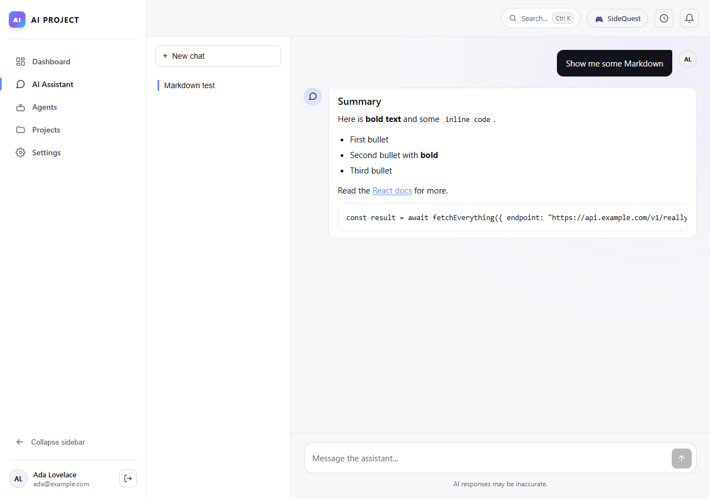

# AI Project

[](https://github.com/fichin/Ai-Project/actions/workflows/ci.yml)

A full-stack React + Express + Postgres workspace for tracking projects and
agents, with an AI assistant chat. In production the chat runs on Anthropic
Claude.

**Live demo:** [ai-project-phi-sand.vercel.app](https://ai-project-phi-sand.vercel.app)
Demo login: `demo@example.com` / `Demo1234!` (pre-verified, no signup needed)

> **The demo account is shared.** Everyone who logs in with it sees the same
> projects, agents and chats, so don't type anything personal into it.
> Sign up for your own account if you want private data.



> Both the frontend and backend are on free-tier hosting, so the first
> load after a period of inactivity can take 30-50 seconds while the
> backend spins back up — subsequent requests are fast.
>
> The live demo has usage limits (open conversations, replies per
> conversation, AI messages per user per day, and a global daily cap) to
> bound the cost of the paid AI key; a message appears in the chat when a
> limit is hit.

## Features

- **AI assistant chat**: Anthropic Claude when `ANTHROPIC_API_KEY` is set.
  Groq is used only when that key is missing and `GROQ_API_KEY` is set; there
  is no runtime fallback, so if Anthropic fails the chat shows an error. With
  neither key, a mock provider answers, and the chat says it's simulated.
- **Chat memory**: each request sends the earlier turns of the conversation,
  trimmed to a character budget (`MAX_HISTORY_CHARS`) so cost per call stays
  bounded. The user message and the AI reply are saved in one database
  transaction, so a failure can't leave half a turn behind.
- **Safe Markdown rendering**: replies render headings, lists, code blocks,
  links and GitHub-flavoured Markdown (tables, strikethrough, task lists) via
  `react-markdown` + `remark-gfm`. Raw HTML is never parsed and output is
  sanitized with `rehype-sanitize`. Wide tables scroll inside the message.
- **Screen reader support in the chat**: the message list is a polite live
  region (`role="log"`), so new replies are read out, and the typing
  indicator is announced as a status.
- **Rate limiting and usage caps**: IP- and email-keyed limiters on
  login, signup and password reset, a per-user limiter on chat, plus
  per-user and global AI usage caps (see [Security](#security)).
- **Monitoring**: a daily GitHub Actions check of the live demo opens an
  `outage` issue when the backend or database is down, with a
  [runbook](docs/runbook.md) for what to do.
- **Database migrations**: numbered SQL files in `server/migrations/`,
  tracked in a `schema_migrations` table with checksums, so each runs once.
  All pending migrations run in one transaction, behind a lock. The runner
  has read-only `--check`, a rolled-back `--dry-run`, and `--baseline` for a
  database that was built by hand (see
  [docs/database-migrations.md](docs/database-migrations.md)). Timestamps
  are `timestamptz`.
- **Tests + CI**: 215 frontend tests (Vitest + React Testing Library) and
  140 backend tests (`node:test`), including integration tests of the real
  API on Postgres 17 in CI, run with lint and a production build on every
  push and PR via GitHub Actions.
- Also: email/password auth with verification and password reset, a
  dashboard with an activity chart, project/agent CRUD with debounced
  search, notifications, an activity feed, user preferences (theme, accent,
  density, landing page), a Ctrl/Cmd+K command palette, and an
  accessibility pass (semantic HTML, keyboard navigation, ARIA labels,
  WCAG AA contrast in both themes).

## Not built yet

- **Agents don't do anything.** They are stored records (name, status,
  project) you can create, edit, search and delete. They don't run tasks or
  call the AI.
- **Chats aren't tied to agents.** Every conversation is a general chat with
  the same system prompt.
- **The assistant can't see your data.** It has no access to your projects
  or agents, and the system prompt tells it not to invent details about them.

## Tech stack

- **Frontend:** React 19, Vite, React Router, TanStack Query
- **Backend:** Node.js, Express
- **Database:** PostgreSQL (Supabase)
- **Email:** Resend (verification/reset links), with a console-log +
  local-outbox fallback for development
- **AI:** Anthropic Claude in production; Groq as fallback config and a mock
  provider for local development
- **Testing/CI:** Vitest, React Testing Library, `node:test`, GitHub Actions
- **Design:** UI designed with [pen.dev](https://www.pen.dev/) (via its MCP tool)

## Run locally

Requires Node.js 22.12+. No database server, Docker or AI key is needed:
the database runs locally on PGlite, and without a key the chat uses the
mock provider.

**1. Database** — in a first terminal:
```bash
cd server
npm install
npm run db:dev       # local Postgres on 127.0.0.1:5433, migrated on start
```
Copy `server/.env.example` to `server/.env` and set the two lines it prints
(`DATABASE_URL` and `DATABASE_POOL_MAX=1`).

**2. Backend** — in a second terminal:
```bash
cd server
npm run dev          # http://localhost:4000
```
Outside production the server refuses to start against a database that
isn't local (or a development Supabase project you name). See
[docs/local-development.md](docs/local-development.md).

**3. Frontend** (in a third terminal, from the repo root):
```bash
npm install
npm run dev          # http://localhost:5173
```

**Environment variables** — `server/.env.example` documents every variable
inline; the essentials:

| Variable | Notes |
|---|---|
| `DATABASE_URL` | Postgres connection string; locally the one `npm run db:dev` prints |
| `DATABASE_POOL_MAX` | Pool size; `1` for the `db:dev` database |
| `DEV_DATABASE_SUPABASE_REF` | Optional: a development-only Supabase project allowed in development |
| `CORS_ORIGIN` | Origin allowed to call this API |
| `FRONTEND_URL` | Where the frontend is deployed — used to build links in verification/reset emails |
| `ANTHROPIC_API_KEY` / `GROQ_API_KEY` | AI provider key(s); falls back to a mock provider when both are unset |
| `RESEND_API_KEY` | Sends real verification/reset emails in production |
| `TRUST_PROXY_HOPS` | Reverse-proxy hop count used to resolve the real client IP for rate limiting — see Security below |
| `DEMO_EMAIL` | The public demo account's email, exempted from the per-email login rate limit |

## Testing

```bash
npm test
```

215 tests (Vitest + React Testing Library) covering hooks, contexts, pages,
and components, including Markdown sanitizing and the chat's live regions.

Backend tests use Node's built-in test runner:

```bash
cd server && npm test
```

140 tests. Unit tests cover the rate limiters (login/email throttling,
IP-spoofing resistance, the demo-account exemption), the chat service, the
AI providers, the development-database guard, and the database: the
migration runner, the TEXT-to-timestamptz conversion, rollback files, and
every changed repository query.

Integration tests (`server/test/`) run the real API over HTTP on a fresh,
migrated database per file: sign-up, verification, login, logout and
password reset; that one user can never read or change another user's
data; the chat cost caps; and that the migrated schema matches the
migrations exactly. Locally they use [PGlite](https://pglite.dev/) (real
Postgres in memory, no server needed); in CI, Postgres 17. Details in
[docs/local-development.md](docs/local-development.md).

## Continuous integration

Every push and pull request to `main` runs through GitHub Actions
(`.github/workflows/ci.yml`): install, lint, the full test suite, and a
production build for the frontend. The backend job starts a Postgres 17
service container (the version Supabase runs), applies every migration with
the same CLI used for production, fails on schema drift, then runs the unit
and integration tests and a syntax check of every source file. A red ✗ means something
is actually broken — lint errors, failing tests, or a build that doesn't
compile — before it ever reaches `main`, let alone the deployed app. See
the **Actions** tab on GitHub for run history.

A separate scheduled workflow (`.github/workflows/keepalive.yml`) checks the
live demo daily. It tells "backend down" apart from "database down", opens a
GitHub issue labelled `outage` when the check fails and closes it on recovery.
What to do when it fires is in [docs/runbook.md](docs/runbook.md).

## Security

**Rate limiting behind the Vercel → Render proxy chain.** The live deployment's
request path is browser → Vercel (rewrites `/api/*` to Render) → Cloudflare (in
front of Render) → Render's own internal proxy → the app. `TRUST_PROXY_HOPS`
(see `server/.env.example`) tells Express how many of those hops to trust when
resolving the real client IP from `X-Forwarded-For`, and production is
configured with `TRUST_PROXY_HOPS=4` on Render to account for that full chain.
This was confirmed directly from Render's own logs via temporary debug
logging: `X-Forwarded-For` consistently carried exactly 4 entries per request
(the real client, Vercel's egress IP on AWS, a Cloudflare IP in front of
Render, and a Render-internal `10.x` address), and the process id stayed
constant across requests, confirming a single backend instance rather than
several independently-counting ones.

Even so, **the IP-based rate limit is treated as best-effort, not as the
primary defense** — Vercel's rewrite can let a spoofed `X-Forwarded-For` pass
through as the first entry of the header on its way to Render, so `req.ip`
isn't fully trustworthy by construction, hop count aside. `loginLimiter`,
`forgotPasswordLimiter`, and `resendVerificationLimiter` (all keyed by
`req.ip`) sit alongside — not instead of — limiters keyed by the normalized
account email (`loginPerEmailLimiter`, `forgotPasswordPerEmailLimiter`,
`resendVerificationPerEmailLimiter`, see `server/src/middleware/rateLimiters.js`).
No amount of IP or `X-Forwarded-For` manipulation can move a request into a
different email's bucket, so these hold regardless. The AI usage caps
(`MAX_CONVERSATIONS_PER_USER`, `MAX_AI_MESSAGES_PER_USER_PER_DAY`,
`MAX_AI_CALLS_PER_DAY` — see `server/src/config/env.js`) are the real
backstop against cost abuse specifically: they bound total spend regardless of
how fast or from how many apparent IPs a user or script hits the API.

**AI output is treated as untrusted.** Assistant replies are rendered as
Markdown without parsing raw HTML, then sanitized with `rehype-sanitize`
(GitHub's allowlist schema), so a reply containing `<script>`, event-handler
attributes or `javascript:` links can't execute, including inside GFM tables.
The sanitizer also prefixes footnote ids with `user-content-` so a reply
can't clobber the app's own element ids. Covered by component tests. Links
open in a new tab with `rel="noopener noreferrer"`.

## Architecture note: the Postgres migration

The app originally ran on a single local SQLite file. It was migrated to
Postgres/Supabase incrementally, one repository at a time, rather than as a
single rewrite: each `db/*Repository.js` module was converted from
synchronous `better-sqlite3` calls to async `pg` queries independently,
keeping the same function signatures so calling routes needed minimal
changes. Data-fetching on the frontend followed the same incremental
approach, moving page-by-page from hand-rolled `useEffect`/`useState`
fetching to TanStack Query, which also brought in cache invalidation,
optimistic updates, and request de-duplication without a big-bang
rewrite. Since then the schema has moved from SQL pasted in by hand to
migrations, and timestamps from SQLite-style TEXT to `timestamptz`. The one
piece intentionally left on SQLite is the local
development email outbox (`server/data/dev-outbox.db`) — a throwaway
convenience for reading back verification/reset links locally, not part
of the app's real data.

## License: MIT
